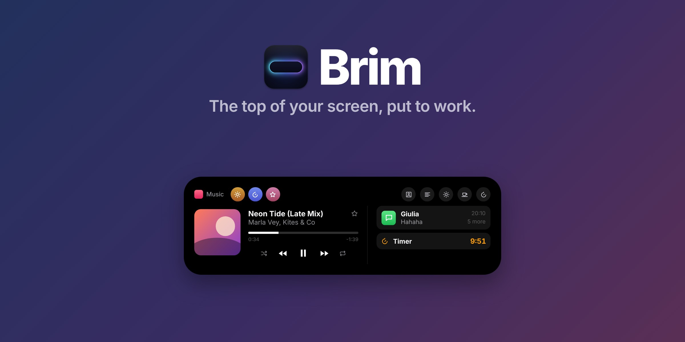
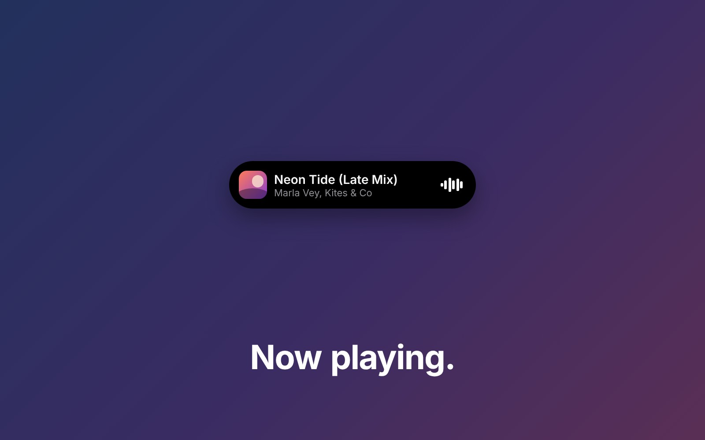
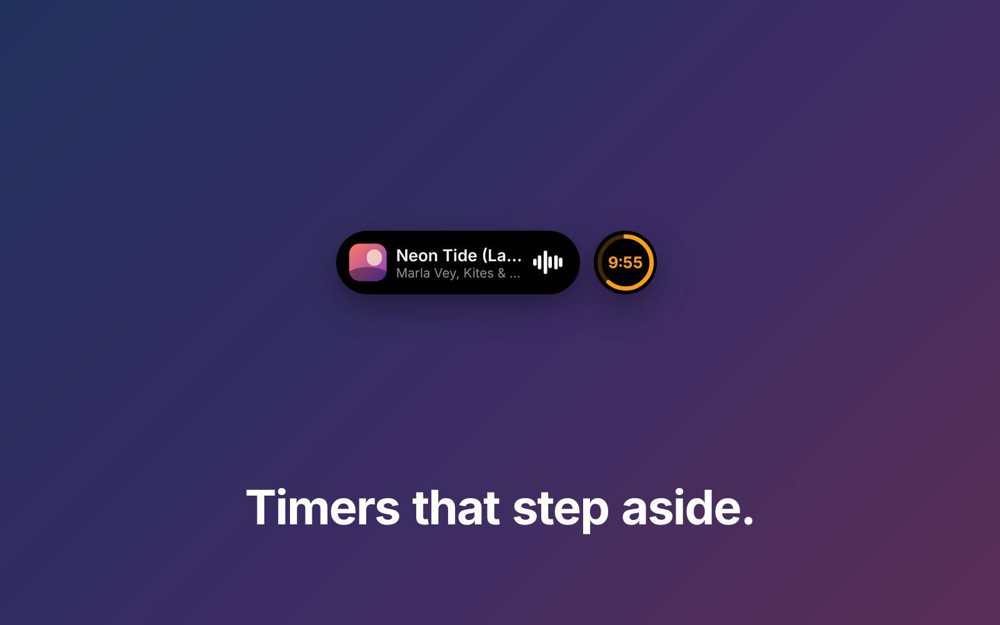
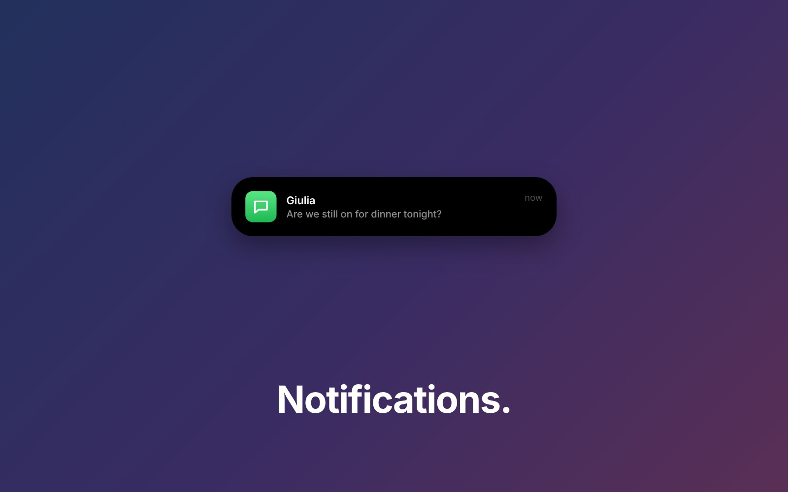
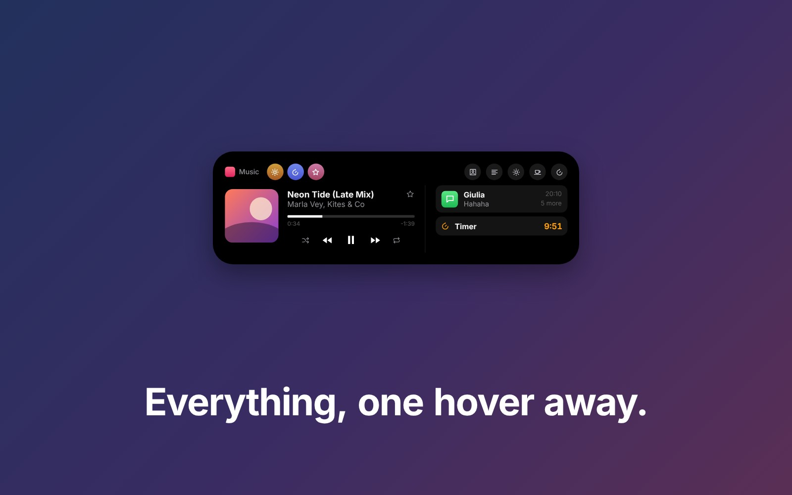
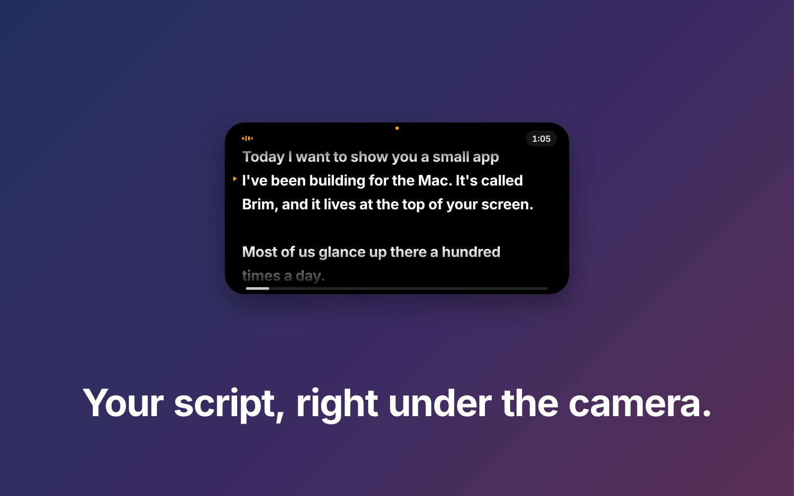
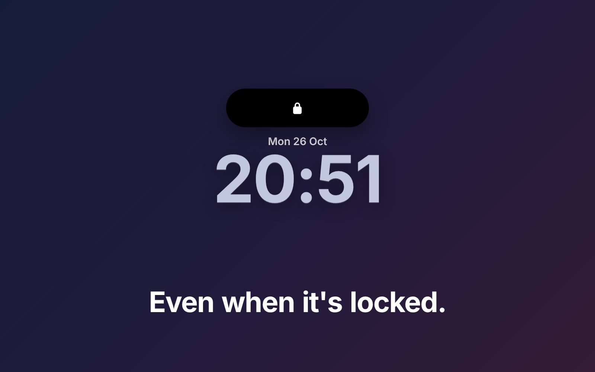

<p align="center"></p>

<p align="center">
  <a href="https://github.com/martinsrepos/Brim/releases/latest"></a>
  
  <a href="LICENSE"></a>
  <a href="https://github.com/martinsrepos/Brim/issues/new?template=feature_request.yml"></a>
</p>

# Brim

**A Dynamic Island for your Mac.** Notifications, music, timers, a teleprompter and the small things your Mac tells you, in one black pill that lives in the notch or floats at the top of any display.

Brim is free and open source. It gets updates often, and new features come from the people who use it: if there's something you'd like it to do, [ask for it](https://github.com/martinsrepos/Brim/issues/new?template=feature_request.yml).

<p align="center"></p>

https://github.com/user-attachments/assets/9db3ae34-746a-4f33-aaa2-a119ff99150d

## What it does

| | |
|---|---|
|  **Now playing.** Artwork, the song and controls, from any app, browsers included. |  **Two things at once.** Timers, meetings and downloads split off into their own circle. |
|  **Every notification.** Banners from every app, plus volume, brightness, AirPods and more. |  **One hover away.** The player, your notifications, a file shelf, a mirror and your own Shortcuts. |
|  **A teleprompter under the camera.** It follows your voice, on your Mac only. |  **On the lock screen.** The pill stays, and notifications only show the app. |

### All features

**Notifications**
- Notifications from every app, with the real app icon
- Stacks in the panel, swipe or flick to clear
- Respect Focus
- Private on the lock screen
- Your own notifications from scripts and Shortcuts

**Music**
- Now playing from any app, browsers included
- Media controls with seek, shuffle, repeat and favourite
- Song changes that swipe, play and pause that morph

**Live activities**
- Two things at once, like iPhone
- Timers, stopwatches and Focus rounds
- Upcoming meetings with Join
- Calls with Mute
- Reminders with Done
- Downloads and AirDrop

**System banners**
- Volume
- Microphone mute
- Monitor brightness
- Keyboard backlight, for Logitech MX Keys
- Charger, battery and charge alert (MacBooks)
- Bluetooth accessories connecting

**Devices**
- AirPods battery, like iPhone
- Low battery for your keyboard, mouse and trackpad
- Logitech battery

**In the panel**
- Hover to expand
- File Shelf with AirDrop
- Shortcuts buttons
- Mirror
- Keep Awake

**Teleprompter**
- Your script under the camera
- Follow My Voice, on your Mac only
- Script editor with highlights and pause markers

**Look and behaviour**
- Notch or floating island
- From solid black to clear glass
- Clock and weather when idle
- Camera and microphone dots
- Lock screen
- Stays out of the way in full-screen apps and games
- Adjustable sizes, notch wings and sounds

Every feature is explained in the [full guide](docs/GUIDE.md).

## Install

1. Download the **Brim DMG** from the [latest release](https://github.com/martinsrepos/Brim/releases/latest) and drag Brim to Applications.
2. Open it. The first time, macOS says it can't check Brim for malware (it isn't notarized yet): go to **System Settings › Privacy & Security**, scroll down and click **Open Anyway**.
3. To see your notifications, give Brim **Full Disk Access** when it asks. Brim opens the right page for you.

Requires macOS 14 or later. Liquid Glass needs macOS 26.

## Privacy

Brim asks for each permission only when a feature first needs it, and works without the ones you skip. No account, no analytics. The only thing it sends anywhere is your city's coordinates, for the weather. Notifications are read on your Mac, and Follow My Voice uses on-device speech recognition only. Details in [SECURITY.md](SECURITY.md).

## Build it yourself

You only need Apple's Command Line Tools:

```bash
xcode-select --install
./build.sh install      # builds, copies to /Applications and launches
./build.sh dmg          # makes build/Brim-<version>.dmg
```

## Feedback

- **Ideas:** [request a feature](https://github.com/martinsrepos/Brim/issues/new?template=feature_request.yml).
- **Bugs:** [report a bug](https://github.com/martinsrepos/Brim/issues/new?template=bug_report.yml). For notifications that don't show, attach the Notification Log (menu bar icon › Notification Log).
- **Code:** pull requests are welcome; see [CONTRIBUTING.md](CONTRIBUTING.md).

## More

- [The full guide](docs/GUIDE.md): every feature and setting, permissions, troubleshooting, how it works, limitations
- [Security policy](SECURITY.md)
- Credits: weather by Open-Meteo and MET Norway (CC BY 4.0); the Now Playing helper is mediaremote-adapter (BSD 3-Clause); the lock screen layer follows SkyLightWindow (MIT).

MIT licence. Brim isn't affiliated with Apple.
